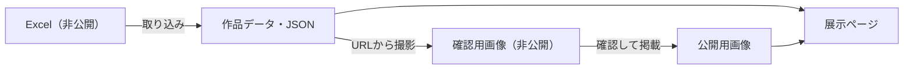

# AIチャットアプリ｜大瓜生山祭2026

京都芸術大学「プログラミング演習」の学生作品を紹介する、**学園祭に合わせた期間限定の展示ページ**です。

**[展示ページを開く](https://creative-cucumbers.github.io/daiuryuzansai-2026/)**

## しくみ

Excelから作品情報を取り込み、確認済みのキャプチャと一緒に表示します。



公開する制作者情報は**イニシャルのみ**です。元Excel・氏名全文・作業記録はGitに含めません。

## 手元で見る

このフォルダで次を実行し、<http://127.0.0.1:8000> を開きます。Python 3 があれば、ビルドやライブラリのインストールは不要です。

```sh
python3 -m http.server 8000 --bind 127.0.0.1
```

**HTMLのダブルクリックでは作品データを読めません。** 簡易サーバーはローカル確認専用です。

## 作品を更新する

1. `input/` またはルートのExcelを最新のものに差し替える。
2. 次を実行し、ブラウザを再読み込みする。

```sh
python3 scripts/import_works.py
```

同じローマ字氏名の回答は、**最新の1件を採用**します。作品情報の修正はExcelで行い、生成されたJSONは直接編集しません。

<details>
<summary>取り込みの詳しい仕様・オプション</summary>

- 読む列：タイムスタンプ、氏名：ローマ字、作品名、作品の説明文、作品のURL。列の順番は自由です。
- イニシャルは入力順の頭文字から作ります（架空例：`Example Person` → `E.P.`）。
- 氏名の大文字小文字・全角半角・連続空白は正規化します。同時刻の回答は後の行・シートを優先します。
- 1人1作品を想定しています。同姓同名や複数作品の提出には判定ルールの変更が必要です。
- URL未入力ならリンクを非表示にします。不正なURLや必須項目不足があれば、既存データを維持して取り込みを中止します。
- AI Studioの `/apps/…` リンクは全画面表示用のパラメータを自動で付けます。
- 作品IDは正規化したローマ字氏名のハッシュから生成します。タイトルやURLの変更では変わりません。
- 採用・重複の記録：`.local/import-report.json`。

```sh
python3 scripts/import_works.py --check               # 確認のみ
python3 scripts/import_works.py "input/回答.xlsx"     # ファイルを指定
```

</details>

## キャプチャを更新する

取得 → 画像を確認 → 掲載、の順で進めます。撮影サイズは **1280×900** です。

```sh
python3 scripts/capture_works.py
python3 scripts/capture_works.py --approve work-xxxxxxxxxxxx
```

画像は `.local/captures/`、状況一覧は `.local/capture-report.md` に保存します。作品IDもこの一覧で確認できます。

**ログイン画面や氏名・アカウント情報が写っていないか確認してから掲載します。** 表示できない作品は保留にできます。

<details>
<summary>撮影ツールの準備・撮り直し</summary>

自動撮影にはChromeと `playwright-cli` が必要です。未導入なら `npm install -g @playwright/cli` で準備します。

```sh
python3 scripts/capture_works.py --id work-xxxxxxxxxxxx --force
```

掲載すると `assets/screenshots/` にコピーされ、公開JSONも更新されます。URLが変わると古い画像は使われなくなるため、再撮影してください。手動画像は `scripts/import_works.py` の `screenshot_path(work)` に合わせて保存し、再取り込みすると反映できます。

</details>

## ファイルの置き場所

| 場所 | 内容 | 公開 |
| --- | --- | --- |
| `input/*.xlsx`・ルートのExcel | フォーム回答の元データ | しない |
| `.local/` | 確認用画像・作業記録・受領した元画像 | しない |
| `data/works.json` | イニシャル・作品名・説明・URL・画像パス | する |
| `assets/screenshots/` | 掲載するキャプチャ | する |
| `scripts/` | Excel取り込み・キャプチャ用スクリプト | する |
| `index.html`・`script.js` | ページ本文・表示と操作 | する |
| `theme.css`・`styles.css` | 配色や文字サイズ・レイアウト | する |

## 公開する

`main` にcommit・pushすると、GitHub Pagesが自動更新します。公開元は **main / リポジトリ直下**です。`.nojekyll` と相対パスを維持してください。

```sh
node --check script.js
python3 -m unittest discover -s tests
git diff --check
git ls-files '*.xlsx' '.local/*'  # 何も表示されないこと
```

<details>
<summary>ページの動作・表示確認</summary>

- カードを押すと作品紹介を拡大表示。拡大後のキャプチャ・ボタンからアプリを開きます。
- 初期表示は登録順。無操作1分で先頭の1行を末尾へ送ります。操作中・詳細表示中・一覧先頭が画面外の場合などは停止します。
- 作品番号は固定、既読や並び順は保存しません。「視差効果を減らす」設定では動きを省略します。
- iPad `1024×768`・`768×1024` は4列、スマホ幅 `390`・`320` は2列。横スクロール・詳細の開閉・Escape・フォーカス復帰を確認します。

</details>
